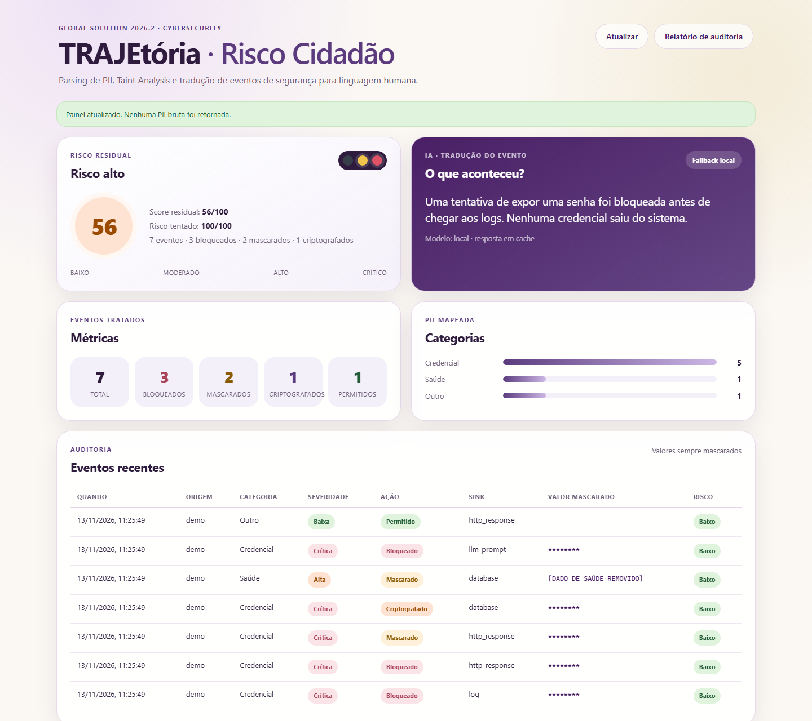

# Relatório de Cybersecurity — TRAJEtória

**FIAP Global Solution 2026.2 · Cybersecurity · CitizenTech**

**Projeto:** TRAJEtória — moda circular para jovens

**Entrega:** 19/11/2026

**Integrantes:** [preencher nome completo e RM de cada integrante]

---

## 1. Sumário executivo

O TRAJEtória é uma plataforma CitizenTech que conecta jovens a doações de roupas, reduzindo o descarte têxtil e ampliando o acesso a vestuário. O fluxo lida com dados pessoais sensíveis: nome, CPF, e-mail, telefone, CEP, endereço, senha, informações de saúde em comentários e dados de menor de idade com responsável.

Esta entrega adiciona uma camada de segurança ao projeto oficial, sem reescrever o aplicativo: catálogo de PII, mascaramento, taint analysis source→sink, backend de proteção, tradução por IA e dashboard web com farol verde/amarelo/vermelho.

| Indicador | Resultado |
| --- | --- |
| Regras/findings de PII na fixture | 20 |
| Arquivos analisados pelo taint analysis | 41 |
| Grupos de sinks analisados | 37 |
| Sinks protegidos | 20 |
| Riscos aceitos e documentados | 17 |
| Sinks sem proteção | 0 |
| Risco residual estático | moderado |
| Testes automatizados | 33 testes aprovados |

## 2. Contexto e problema

A LGPD (Lei 13.709/2018) exige finalidade, necessidade e segurança no tratamento de dados pessoais. Em um app comunitário, os riscos típicos são:

- PII em logs de console, arquivos de log ou ferramentas de observabilidade.
- PII em respostas HTTP públicas ou em telas de erro.
- PII enviada a modelos de IA em prompts.
- PII em banco local sem criptografia e em exportações.
- Dados de saúde e de menores de idade tratados sem proteção reforçada.

A solução adota o princípio de minimização: o dado bruto só existe na origem; antes de cada sink, ele é mascarado, bloqueado ou criptografado.

## 3. Arquitetura da solução

~~~
App Expo / React Native
  ├─ src/security (catálogo, mascaramento, risco, taint)
  ├─ src/services/securityService (eventos best-effort)
  └─ telas entrega/feedback (consentimento + erros seguros)
        │
        ▼
Backend Node + TypeScript (sem dependências de runtime)
  ├─ piiMiddleware (log, IA, resposta, pedido, feedback)
  ├─ crypto AES-256-GCM + hash + comparação constante
  ├─ eventStore (máx. 500 eventos sanitizados)
  ├─ aiTranslator (OpenAI → Gemini → fallback local)
  └─ rotas /api/security, /api/orders, /api/feedback
        │
        ▼
Dashboard web (backend/dashboard)
  └─ farol verde/amarelo/vermelho + métricas + eventos
~~~

## 4. Catálogo de PII e mascaramento

| Categoria | Exemplos | Estratégia | Severidade |
| --- | --- | --- | --- |
| Identificação | Nome, CPF, RG, passaporte | [NOME REMOVIDO] / ***.***.***-** | alta/crítica |
| Contato | E-mail, telefone | [CONTATO REMOVIDO] / (**) *****-**** | alta |
| Endereço | CEP, logradouro, número, bairro, cidade, UF | [ENDEREÇO REMOVIDO] | média/alta |
| Credencial | Senha, token, chave | ******** / [CREDENCIAL REMOVIDA] | crítica |
| Saúde | Doença, medicamento, tratamento | [DADO DE SAÚDE REMOVIDO] | crítica |
| Menor | Menor de idade, responsável | *** / [RESPONSÁVEL REMOVIDO] | crítica |
| Financeiro | Cartão, conta, Pix | [DADO FINANCEIRO REMOVIDO] | crítica |

O catálogo combina dois mecanismos:

1. **Detecção por padrão**: regex para CPF (com dígito verificador), e-mail, telefone, CEP, cartão, Pix, senha e termos de saúde.
2. **Detecção por nome de campo**: mesmo que o valor não case com um padrão, campos como nome, cpf, telefone, endereco, senha, comentario, menor_de_idade e responsavel são mascarados.

Exemplo de redação da fixture:

~~~json
{
  "nome": "[NOME REMOVIDO]",
  "cpf": "[DOCUMENTO REMOVIDO]",
  "email": "[CONTATO REMOVIDO]",
  "telefone": "[CONTATO REMOVIDO]",
  "cep": "[ENDEREÇO REMOVIDO]",
  "endereco_logradouro": "[ENDEREÇO REMOVIDO]",
  "endereco_numero": "[ENDEREÇO REMOVIDO]",
  "endereco_bairro": "[ENDEREÇO REMOVIDO]",
  "endereco_cidade": "[ENDEREÇO REMOVIDO]",
  "endereco_uf": "[ENDEREÇO REMOVIDO]",
  "senha": "********",
  "comentario": "[DADO DE SAÚDE REMOVIDO]",
  "menor_de_idade": "***",
  "responsavel": "***"
}
~~~

## 5. Taint analysis source→sink

A análise estática percorre app, src e backend, identifica fontes de PII e sinks (console, log, resposta HTTP, prompt de IA, banco, exportação e tela de erro). O relatório completo fica em docs/cybersecurity/evidencias/taint-report.json.

| Métrica | Valor |
| --- | --- |
| Arquivos analisados | 41 |
| Arquivos com fontes de PII | 15 |
| Ocorrências de fonte | 48 |
| Grupos de sink | 37 |
| Ocorrências de sink | 103 |
| Protegidos | 20 |
| Risco aceito | 17 |
| Sem proteção | 0 |

Principais achados:

- **app/(jovem)/acompanhar.tsx** · Alert.alert · linhas 12, 21 · accepted_risk · mensagens estáticas
- **app/(jovem)/catalogo.tsx** · Alert.alert · linhas 21 · guarded · safeErrorMessage
- **app/(jovem)/detalhe/[id].tsx** · Alert.alert · linhas 15 · guarded · safeErrorMessage
- **app/(jovem)/entrega.tsx** · reportSecurityEvent · linhas 24, 31 · guarded · scanLocal + hasConsent + safeErrorMessage
- **app/(jovem)/entrega.tsx** · Alert.alert · linhas 25, 33, 35 · guarded · scanLocal + hasConsent + safeErrorMessage
- **app/(jovem)/entrega.tsx** · confirmOrder · linhas 30 · guarded · scanLocal + hasConsent + safeErrorMessage
- **app/(jovem)/feedback.tsx** · Alert.alert · linhas 16, 30, 32 · guarded · sanitizeFreeText + hasConsent + safeErrorMessage
- **app/(jovem)/feedback.tsx** · reportSecurityEvent · linhas 22, 29 · guarded · sanitizeFreeText + hasConsent + safeErrorMessage
- **app/(jovem)/feedback.tsx** · saveFeedback · linhas 28 · guarded · sanitizeFreeText + hasConsent + safeErrorMessage
- **app/(jovem)/meu-pedido.tsx** · Alert.alert · linhas 12, 14 · accepted_risk · mensagens estáticas + nome da peça
- **app/(jovem)/perfil.tsx** · Alert.alert · linhas 15 · accepted_risk · mensagens estáticas
- **app/consentimento.tsx** · Alert.alert · linhas 19 · accepted_risk · mensagens estáticas
- **app/index.tsx** · Alert.alert · linhas 24 · accepted_risk · mensagens estáticas
- **backend/http/body.ts** · sendJson · linhas 12, 22 · guarded · limite de body + erro estático

A análise dinâmica executa o mesmo payload fictício por oito sinks. Nenhum valor bruto é retornado:

| Sink | Autenticado | Ação | Resultado |
| --- | --- | --- | --- |
| console | não | blocked | bloqueado |
| log | não | blocked | bloqueado |
| http_response | não | blocked | bloqueado |
| http_response | sim | masked | permitido |
| llm_prompt | não | blocked | bloqueado |
| database | não | encrypted | permitido |
| export | não | blocked | bloqueado |
| error_screen | não | blocked | bloqueado |

Riscos aceitos e documentados: o SQLite local do app é um sandbox do dispositivo; o backend criptografa a PII em repouso no fluxo de pedidos. Os seeds usam dados fictícios de demonstração. A chave de criptografia de desenvolvimento deve ser substituída em produção.

## 6. Backend de segurança

- **Consentimento obrigatório** em /api/orders e /api/feedback; o app também bloqueia pedido e feedback sem consentimento.
- **Criptografia AES-256-GCM** para PII em repouso, com IV aleatório e tag de autenticação.
- **Comparação de token em tempo constante** para o token de demonstração.
- **Limite de body** de 1 MB e respostas de erro estáticas, sem stack trace.
- **Cabeçalhos de segurança** e CORS controlado.
- **Event store** com no máximo 500 eventos sanitizados, sem PII bruta.
- **Rotas**: GET /health, GET /api/security/dashboard, POST /api/security/demo, POST /api/security/scan, GET/POST /api/security/events, POST /api/security/clear, GET /api/security/report, POST /api/orders, GET /api/orders/:id, POST /api/feedback.

## 7. Tradução por IA

O tradutor recebe apenas campos sanitizados do evento (sink, ação, categoria, severidade, regras e valor mascarado). O prompt nunca inclui PII bruta.

Ordem de execução: OpenAI (se OPENAI_API_KEY existir) → Gemini (se GEMINI_API_KEY existir) → fallback local determinístico. O resultado é cacheado em memória. Sem chaves, a demonstração continua funcionando offline.

Exemplo de mensagem traduzida:

~~~text
Uma tentativa de expor uma senha foi bloqueada antes de chegar aos logs. Nenhuma credencial saiu do sistema.
~~~

## 8. Dashboard web com farol de risco

O dashboard fica em /dashboard e é servido pelo backend. Ele exibe:

- Farol verde (0–19), amarelo (20–49), laranja (50–74) e vermelho (75–100).
- Score de risco, eventos bloqueados, mascarados, criptografados e permitidos.
- Distribuição por severidade e categoria.
- Últimos eventos sanitizados com tradução em linguagem simples.
- Aviso explícito de que nenhuma PII bruta é retornada.

A captura do dashboard é gerada por npm run security:dashboard-shot e salva em docs/cybersecurity/evidencias/dashboard.png.

## 9. Integração no aplicativo

- **Entrega**: scan local do endereço; bloqueio de credencial, saúde e menor de idade; evento de segurança best-effort; erros seguros.
- **Feedback**: sanitização do comentário com sanitizeFreeText; aviso de PII; consentimento; erros seguros.
- **Repositórios**: confirmOrder e saveFeedback exigem consentimento antes de qualquer gravação.
- **Serviço**: reportSecurityEvent envia somente eventos mascarados e falha em silêncio se o backend estiver offline.

## 10. Evidências e testes

Comandos executados:

~~~powershell
npm run security:build
npm run security:test
npm run security:audit
npm run security:demo
npm run security:evidence
npm run security:report
npm run security:pdf
npm run security:dashboard-shot
npm run security:zip
~~~

Arquivos de evidência em docs/cybersecurity/evidencias:

- pii-scan.json — catálogo e redação da fixture.
- taint-traces.json — oito sinks, ações e eventos.
- risk-matrix.json — cenários e faixas do farol.
- taint-report.json — análise estática completa.
- taint-report.md — versão legível do relatório.
- evidence.html — página de evidências para o PDF.
- dashboard.png — captura do dashboard.
- demo-result.json — resultado da simulação end-to-end.

Resultado dos testes: **33 testes aprovados**, cobrindo PII, taint, risco, criptografia, tradutor e servidor HTTP.

## 11. Riscos residuais e melhorias

1. SQLite local do app mantém PII em texto claro dentro do sandbox do dispositivo. Mitigação futura: SQLCipher ou criptografia de campo.
2. A chave de criptografia padrão é de desenvolvimento. Em produção, usar segredo gerenciado e rotação.
3. O token de demonstração não substitui autenticação real. Em produção, usar OAuth/JWT com escopos.
4. Não há rate limiting no backend de demonstração. Adicionar limite por IP/usuário em produção.
5. Dados de seed são fictícios; nunca usar dados reais de cidadãos em demonstrações.
6. A tradução por IA depende de provedores externos; o fallback local garante disponibilidade, mas a qualidade é menor.

## 12. Como executar

~~~powershell
npm install
npm run security:test
npm run security:audit
npm run security:demo
npm run security:evidence
npm run security:report
npm run security:pdf
npm run security:start
~~~

Dashboard: http://localhost:3333/dashboard

## 13. Checklist de entrega

- [x] Catálogo de PII e mascaramento.
- [x] Taint analysis source→sink (estática e dinâmica).
- [x] Backend com consentimento, criptografia e eventos.
- [x] Tradução por IA com fallback local.
- [x] Dashboard web com farol verde/amarelo/vermelho.
- [x] Integração mínima no app.
- [x] Testes automatizados.
- [x] Evidências JSON/HTML e captura do dashboard.
- [x] Relatório em Markdown/HTML.
- [x] PDF final e ZIP de código.
- [ ] Preencher nomes e RMs dos integrantes.

## 14. Referências

- FIAP Global Solution 2026.2 — enunciado de Cybersecurity.
- OWASP Top 10 2021: A01 Broken Access Control, A02 Cryptographic Failures, A03 Injection, A09 Security Logging and Monitoring Failures.
- LGPD, Lei 13.709/2018, arts. 6º e 46.
- Documentação do projeto TRAJEtória e repositório oficial BitWise-FIAP/fiap-mdi-TRAJEtoria.

Relatório gerado em 13/11/2026, 11:30.